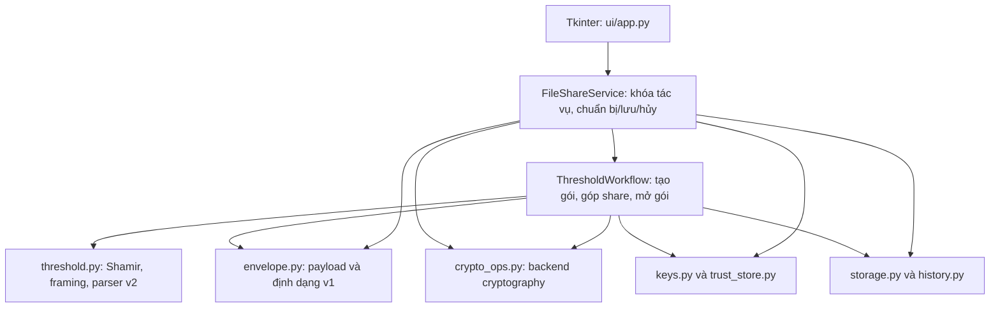

# Phân tích dự án và đối chiếu công việc của nhóm

Ngày kiểm tra: **10/11/2026**, múi giờ Asia/Bangkok. Phiên bản nguồn: **`a6106d1d4d5869d87aafa3af79acd4597066d607`**.

## 1. Kết luận chính

**Phần mềm cốt lõi đã triển khai và vượt qua bộ kiểm thử hiện có. Tuy nhiên, chưa đủ bằng chứng để xác nhận toàn bộ công việc và hồ sơ nộp bài đã hoàn thành theo ba tài liệu được cung cấp.** Các thiếu hụt chính là đặc tả cập nhật, kết quả nghiệm thu có người chạy/review, báo cáo, hướng dẫn có ảnh, slide, runbook, video và bản phát hành có kiểm kê/checksum.

Đặc biệt, phạm vi đã thay đổi: tài liệu ban đầu quy định **một người nhận, `.sfile` v1, nhóm 5 người**; bản hiện tại có giao diện **Shamir 2-trên-3, `.sfile2`/`.sapproval`**, và README phân công **7 người**. Vì vậy, việc chạy tốt bản hiện tại chưa tự chứng minh đã đáp ứng mọi tiêu chí của proposal gốc. Nhóm cần thống nhất và ghi lại phạm vi được nghiệm thu.

**Riêng Quang:** phần công cụ và test đã có nền tảng đáng kể; việc còn lại chủ yếu là hoàn thiện ma trận nghiệm thu, bằng chứng, benchmark thành báo cáo, fixture theo giao thức mới và tài liệu/demo. Không cần viết lại bộ test từ đầu.

## 2. Nguồn, phương pháp và giới hạn đánh giá

Đã đọc và đối chiếu:

- `C:\Users\Admin\Downloads\Proposal_va_kich_ban_demo_chia_se_tep_an_toan.pdf`: 22 trang, v1.0 ngày 09/11/2026; yêu cầu sản phẩm, thiết kế v1, 60 mã kiểm thử và demo.
- `C:\Users\Admin\Downloads\Ke_hoach_trien_khai_du_an_nhom_5_nguoi.pdf`: 29 trang, v1.1; 40 đầu việc, vai trò kiểm thử, báo cáo và điều kiện kết thúc.
- `C:\Users\Admin\Downloads\PROJECT_STRUCTURE_AND_TASKS.md`: v1.2; cấu trúc mục tiêu, checklist, API, 40 đầu việc T1.1–T5.8, 60 ID I/S/R/A/P/O/L.
- Mã nguồn, tests, tools, README, cấu hình CI, Git log và danh sách tệp được Git quản lý trong thư mục dự án.

Những câu như “chưa chạy”, “cần triển khai” và các ô `[ ]` trong tài liệu là trạng thái của **kế hoạch**, không được dùng làm kết luận về mã hiện tại. Ngược lại, một tệp tồn tại hoặc một commit có tên “complete” cũng không tự chứng minh nghiệm thu đã xong.

Quy ước trong các bảng:

- **Có kỹ thuật:** có chức năng thực và test liên quan đạt trong lượt kiểm tra này. Vẫn cần bằng chứng review/nghiệm thu nếu đầu việc yêu cầu.
- **Một phần:** có đầu ra nhưng còn thiếu thành phần được yêu cầu, hoặc phạm vi đã đổi.
- **Thiếu bản bàn giao:** chưa thấy đầu ra cần nộp trong snapshot hiện tại.
- **Chưa xác minh:** không thể suy ra từ repo, ví dụ chạy trên máy khác, người review đã duyệt, lịch diễn tập, kết quả CI từ xa.

Đánh giá theo **phần việc được giao**, không quy kết ai chưa làm chỉ vì không thấy tên người đó trong commit. Tài liệu hoặc video có thể được lưu ngoài repo; những mục đó cần bổ sung đường dẫn để xác minh. Không truy cập GitHub từ xa, không xác nhận trạng thái Actions, lời mời thành viên hay review PR trực tuyến.

## 3. Kết quả chạy thực tế

Môi trường kiểm tra: Windows 11 build 26100, Python **3.14.8**, `cryptography==50.0.2`, `pytest==9.2.0`. Các dependency trong `requirements.txt` đã cài được trên môi trường này. Đây không phải chứng nhận cho mọi máy hoặc cho môi trường Python 3.12 được README/CI chỉ định.

| Kiểm tra | Kết quả thực tế | Bằng chứng |
|---|---|---|
| `python -m secure_share --check` | Môi trường và các module tích hợp sẵn sàng; version ứng dụng 0.1.0 | Đã chạy trong phiên kiểm tra; riêng `--check` không chứng minh nghiệp vụ |
| `python -m tools.case_report --run --json ...` | **441 test đạt, 190 subtest đạt**, 86,56 giây; không fail/skip | [Log đầy đủ](.test-results/audit/test-run-verified.log) |
| Ánh xạ 60 mã gốc | **60/60 ID có test liên kết; mọi test liên kết đều đạt** | [JSON kết quả](.test-results/audit/cases-verified.json), [ma trận 60 ID](.test-results/audit/ACCEPTANCE_MATRIX.md) |
| Demo tự động hiện tại | Tạo gói thành công, một người giữ bị chặn khi thiếu contribution, cả 3 cặp mở đúng | [Demo JSON](.test-results/audit/demo-verified.json) |
| Benchmark | 0 B, 1 KiB, 1 MiB, 10 MiB; mỗi kích thước 3 lần; mọi kết quả so byte/hash đều khớp | [Benchmark JSON](.test-results/audit/benchmark-verified.json) |

Lượt test và benchmark đầu tiên trong sandbox bị chặn quyền tại thư mục tạm Windows. Đã chạy lại với quyền được cho phép và lấy **lượt verified** làm bằng chứng. Những lỗi quyền của lượt đầu không được tính là lỗi nghiệp vụ của sản phẩm.

JSON acceptance ghi commit đầy đủ, thời điểm chạy UTC, OS, Python, pytest, test node, outcome và thời gian từng pha. Khi bắt đầu chạy test, working tree sạch. Các kết quả này do phiên phân tích tạo ra, **không phải bằng chứng Quang hoặc các runner trong kế hoạch đã tự chạy/ký xác nhận trước đó**.

Có 152 test node khác nhau được liên kết tới 60 ID, với 185 liên kết do một số test gắn nhiều ID. Các test Shamir bổ sung cũng được chạy trong tổng 441 test; phần lớn chưa nằm trong ma trận 60 ID, chỉ test Tkinter Shamir gắn R01. Vì thế:

1. Không được cộng 60 ID, 441 test và 190 subtest thành số ca nghiệm thu độc lập.
2. “60/60 ID có test đạt” không tự chứng minh mọi biến thể trong proposal đã được người độc lập thực hiện.
3. Test Tkinter thật có chạy, nhưng các dialog trong bài test được điều khiển tự động; đây chưa phải buổi thao tác và quan sát thủ công trên hai máy.

## 4. Dự án hiện tại hoạt động thế nào

### 4.1. Mục tiêu và các tệp trao đổi

Ứng dụng desktop offline cho phép một người gửi mã hóa một tệp và chỉ định ba khóa người giữ. Người giữ phải phối hợp hai share khác nhau để khôi phục khóa AES. Ứng dụng không có máy chủ, tài khoản online hay cơ chế tự truyền file; người dùng tự gửi qua USB, chat hoặc email.

| Loại tệp | Vai trò |
|---|---|
| `.sfile2` | Gói chứa nội dung mã hóa, ba share được bọc riêng và chữ ký người gửi; cùng một gói được chuyển cho cả ba người giữ |
| `.sapproval` | Share đóng góp được bọc cho một người giữ cụ thể và gắn với đúng gói |
| Public bundle JSON | Hai public key theo vai trò; nhập xong vẫn cần xác minh fingerprint |
| `.sbackup` | Bản sao hồ sơ, chứa private PEM đã mã hóa; metadata hồ sơ không được mã hóa toàn bộ như một container riêng |
| `.sfile` | Giao thức v1 còn ở service và các bài regression, nhưng giao diện hiện tại không cung cấp luồng gửi/nhận v1 |

### 4.2. Các lớp của hệ thống

- [application.py](secure_share/application.py) lắp `KeyStore`, `TrustStore`, `LocalStorage`, history và service. Runtime mặc định trên Windows ở `%LOCALAPPDATA%\Shared-Files-Security`, không ở thư mục repo.
- [models.py](secure_share/models.py), [ports.py](secure_share/ports.py), [errors.py](secure_share/errors.py), [config.py](secure_share/config.py) định nghĩa hợp đồng, kiểu dữ liệu, lỗi và giới hạn chung.
- [service.py](secure_share/service.py) giữ một tác vụ hoạt động, không cho chạy chồng khi có plaintext chờ lưu; `PreparedReceive` chỉ đưa handle và metadata ra UI.
- [threshold_workflow.py](secure_share/threshold_workflow.py) điều phối nghiệp vụ v2; [threshold.py](secure_share/threshold.py) chứa phép chia/ghép share, cấu trúc gói và contribution.
- [keys.py](secure_share/keys.py) tạo hai cặp RSA khác nhau, lưu private key dưới dạng PEM PKCS8 có mã hóa bên trong JSON hồ sơ; giữ tối đa 10 thế hệ khóa. [trust_store.py](secure_share/trust_store.py) phân biệt chưa xác minh, đã xác minh và vô hiệu hóa.
- [storage.py](secure_share/storage.py) đọc cap + 1 byte, ghi tạm cùng thư mục, publish/replace khi hoàn chỉnh, kiểm protected paths và samefile, có journal phục hồi sau gián đoạn.
- [ui/app.py](secure_share/ui/app.py) gồm ba tab: khóa, liên hệ và chia sẻ 2-trên-3; chạy tác vụ qua executor một worker, chuyển kết quả về Tkinter bằng queue/poll.

UI không tự làm AES/RSA. Tuy vậy, thao tác quản lý hồ sơ/liên hệ gọi trực tiếp `app.keys`, `app.trust`, `app.storage`, nên kiến trúc thực tế rộng hơn sơ đồ “mọi thao tác UI đều qua service” trong tài liệu ban đầu.

### 4.3. Luồng tạo và mở gói

1. Người gửi chọn ba contact đã xác minh; service chặn trùng ID, trùng khóa, trùng vai trò và khóa trùng người gửi. Fingerprint đã xác nhận được truyền vào request để phát hiện contact đổi trước lúc thực thi.
2. Đọc snapshot tệp tối đa 10 MiB; đóng payload chứa metadata filename và raw bytes. Sinh khóa AES 32 byte, nonce 12 byte và transfer ID 128 bit.
3. Chia khóa bằng đường thẳng `f(x)=K+a*x mod p`, `p=2^521-1`; share là chỉ số 1/2/3 kèm giá trị trường. Hai điểm khác nhau nội suy được `f(0)=K`.
4. Tạo commitment SHA-256 cho từng share, gắn transfer ID và chỉ số. Mỗi share được RSA-OAEP bọc bằng public encryption key của người giữ tương ứng.
5. AES-256-GCM mã hóa payload; AAD ràng buộc raw header và ba wrapped share. RSA-PSS ký header, wrapped shares, nonce và ciphertext/tag.
6. Người góp đọc gói có cap, tra khóa người gửi đã pin, xác minh PSS rồi mới mở share của mình. Share được bọc lại cho người giữ đích cùng package ID, thành `.sapproval`.
7. Người mở kiểm chữ ký, tìm đúng private encryption key, kiểm contribution thuộc đúng gói/đích và nguồn khác mình; mở hai share, kiểm chỉ số/commitment rồi nội suy khóa AES.
8. Sau khi GCM và payload hợp lệ, service giữ bản rõ trong bộ nhớ. Người dùng chọn Save As hoặc hủy. Chỉ khi file được commit thành công mới trả receipt, tiêu thụ handle và ghi lịch sử.

`package_id` được tính bằng SHA-256 của chữ ký gói. Contribution không có chữ ký riêng của người góp; việc chấp nhận share dựa vào bọc OAEP, binding gói/đích và commitment đã được người gửi ký. Không mô tả `.sapproval` như chứng cứ có chữ ký độc lập rằng một người vừa phê duyệt tại thời điểm hiện tại.

### 4.4. Các bảo vệ đã có và các giới hạn cần hiểu

Các điểm đã triển khai có giá trị: pin hai fingerprint; verify trước unwrap/decrypt; chặn gói lỗi schema/Base64/độ dài; giữ raw header khi verify; tách khóa ký và khóa mã hóa; giữ nguồn và đích cũ khi lỗi ghi có kiểm soát; không tự mở/chạy output; history lỗi sau commit vẫn báo thành công kèm cảnh báo.

Giới hạn:

- 2-trên-3 là hai **khóa/share khác nhau**, không chứng minh hai con người độc lập; một người sở hữu hai bộ khóa vẫn có đủ share.
- Người gửi biết tệp gốc và đã tạo khóa AES. Mô hình ngưỡng nói về các người giữ nhận gói, không ngăn chính người gửi biết nội dung.
- Sau khi có hai share, người mở có thể sao chép plaintext; contribution có thể dùng lại cho cùng gói và khóa đích. Không có thu hồi/DRM/hết hạn offline hay yêu cầu hai người luôn online.
- Nếu lộ đủ khóa/share, hoặc một khóa cùng contribution sử dụng được, gói cũ có thể bị mở. Không suy diễn kết quả “lộ một khóa Bob mở v1” thành kết luận “một khóa bất kỳ mở được v2”.
- Ghim nhầm fingerprint sẽ tin nhầm khóa; lộ khóa ký vẫn có thể tạo gói được chấp nhận khi pin còn hiệu lực.
- Tên tệp nằm trong payload mã hóa; header còn lộ fingerprint, cấu trúc người giữ và dung lượng gần đúng.
- Bỏ tham chiếu trong Python không bảo đảm xóa sạch bí mật khỏi RAM; crash có thể để lại plaintext temp trước khi phục hồi/dọn.
- Chạy bộ test hữu hạn không phải chứng nhận an toàn mật mã toàn diện.

`crypto_ops.py` có cả hàm mật mã tự viết phục vụ học tập và lớp `CryptoOps` dùng `cryptography`. **Ứng dụng thực được lắp với `CryptoOps`**, không dùng toàn bộ đường AES/RSA Python thuần. Một số tools/test v1 vẫn dùng các hàm thuần. Khi thuyết trình cần nói rõ đường thực thi nào được dùng; không nói toàn bộ repo đều chỉ gọi thư viện, cũng không nói desktop dùng toàn bộ AES/RSA tự cài.

## 5. Chênh lệch giữa kế hoạch và snapshot hiện tại

| Nội dung | Kế hoạch gốc | Hiện tại | Việc cần chốt |
|---|---|---|---|
| Người nhận | Một người nhận/gói | Ba người giữ, cần hai share | Có chấp nhận thay scope hay phải giữ thêm giao diện v1? |
| Định dạng | `.sfile` v1, OAEP bọc AES key, label rỗng | `.sfile2`, OAEP bọc share và contribution, label riêng | Cần đặc tả v2 và bảng phân biệt v1/v2 |
| Nhân sự | 5 người | README ghi thêm Hiền Anh và Vinh | Cập nhật trách nhiệm nghiệm thu, demo, setup; tránh bỏ sót do chuyển giao |
| Cấu trúc UI/test | Nhiều view, `conftest.py`, các file test chuyên biệt | UI trong `app.py`; fixture và test phân bố khác | Khác tên file không tự đồng nghĩa thiếu chức năng |
| Hồ sơ runtime | Cây thư mục/profile PEM dự kiến | JSON/profile và JSON/contact, PEM mã hóa nằm trong JSON; runtime ngoài repo | Cập nhật schema và hướng dẫn sao lưu |
| Tài liệu | `docs/`, chương báo cáo, runbook, slide | Không còn thư mục `docs/` trong HEAD | Khôi phục/chỉnh nội dung phù hợp v2 và bàn giao |
| Môi trường | PDF tham chiếu 3.14.x; có thể thống nhất bản khác | README/launcher/CI 3.12; setup checklist nói 3.10+ | Chọn một mốc chính, ghi thêm mốc đã thực sự thử |

Lịch sử Git xác nhận commit **`f5dad31`** xóa 12 tài liệu nháp: architecture, crypto_design, interfaces, key_management, key_spec, package_format, presentation/outline, ba chương report 01–03, requirements và threat_model. Do đó, chúng đã từng tồn tại nhưng không nằm trong bản bàn giao hiện tại. Không nên khôi phục nguyên xi đặc tả v1 rồi coi là tài liệu v2.

Tệp `PROJECT_STRUCTURE_AND_TASKS.md` được cung cấp ở Downloads chưa nằm trong repo. Các file `user_guide.md`, `test_plan.md`, `test_results.md`, `benchmark_results.md`, `demo_runbook.md`, chương report 04–05 và checklist manual cũng chưa có ở HEAD. README có tóm tắt nhưng chưa thay thế các đầu ra chi tiết được giao.

## 6. Đối chiếu đủ 40 đầu việc

Các mục “Có kỹ thuật” dưới đây xác nhận triển khai/test, không xác nhận người đứng tên đã hoàn thành độc lập toàn bộ quy trình review hay các mốc D1–D20.

### 6.1. Tiệp — T1.1 đến T1.8

| ID | Công việc | Trạng thái | Bằng chứng và phần còn lại |
|---|---|---|---|
| T1.1 | Kho mã, cấu trúc, ticket | Một phần | Có entrypoint, README, CONTRIBUTING, requirements, gitignore, templates và lịch sử merge PR. Chưa có bảng 40 ticket/owner/reviewer trong repo; chưa xác minh cả 5 máy/nhánh. |
| T1.2 | Hợp đồng chung | Một phần | Có config/models/errors/ports, test contracts/ports/adapters. `docs/interfaces.md` đã bị xóa; thiếu hợp đồng cuối bao gồm threshold. |
| T1.3 | Điều khiển gửi | Có kỹ thuật | `send_file()` v1 và `send_threshold()` v2 có đọc cap, trust, unlock, tạo gói, save; test tích hợp đạt. |
| T1.4 | Điều khiển nhận | Có kỹ thuật; cần cập nhật | V1 có thứ tự kiểm tra rõ; v2 có verify, share binding, prepare/save/discard. `_run_threshold()` chưa gắn stage chi tiết khi workflow lỗi; xem mục 9. |
| T1.5 | Chính sách, history | Có kỹ thuật | Có duplicate warning, ghi history sau save, handle hết hiệu lực, xử lý history lỗi sau commit; test đạt. |
| T1.6 | Tích hợp hằng ngày | Một phần/chưa xác minh | Có nhiều commit/merge và full suite đạt tại HEAD. Chưa thấy bảng lỗi và bằng chứng từng gate/ngày/review độc lập. |
| T1.7 | Bản chạy tái lập, release | Một phần | Có launcher, dependency pin, CI hai OS. Đã cài/test trên máy này; chưa xác minh clean checkout máy khác, RC/release nộp, checksum và sự khớp video/báo cáo. Không thấy Git tag. |
| T1.8 | Báo cáo tổng và bàn giao | Thiếu bản bàn giao | Không có báo cáo ghép, inventory và hồ sơ diễn tập cuối; các tài liệu kiến trúc/scope/chương 01 đã bị xóa. |

### 6.2. Nhật — T2.1 đến T2.8

| ID | Công việc | Trạng thái | Bằng chứng và phần còn lại |
|---|---|---|---|
| T2.1 | Sinh bộ danh tính | Có kỹ thuật | `KeyStore._generation()` tạo hai RSA-3072 e=65537, test phân biệt hai khóa đạt. |
| T2.2 | Lưu và mở khóa riêng | Có kỹ thuật | PKCS8 có mã hóa, kiểm passphrase, sai mật khẩu/PEM lỗi không ghi đè hồ sơ tốt; test đạt. |
| T2.3 | Bundle, fingerprint | Có kỹ thuật; thiếu spec | `validate_bundle()`, `fingerprint()` dùng DER SPKI, kiểm loại/tham số/trùng khóa. Thiếu `public_identity_format.md` trong bản nộp. |
| T2.4 | Trust, thay khóa | Có kỹ thuật | Unverified/verified/disabled, so hai fingerprint, cảnh báo trùng tên/khóa thay, không pin âm thầm; test contacts/trust đạt. |
| T2.5 | Đúng khóa và vai trò | Có kỹ thuật | Resolver theo fingerprint và generation, unlock kiểm public key khớp; v2 tìm đúng một vị trí holder; test sai vai trò/người nhận đạt. |
| T2.6 | Kho hồ sơ bền vững | Có kỹ thuật | Atomic save, cap profile 256 KiB, bundle 8 KiB, contact 16 KiB; schema/restart/lỗi ghi có test. Không tự reset pin hỏng. |
| T2.7 | Đổi và phục hồi khóa | Có kỹ thuật | Rotate giữ khóa cũ; backup/restore kiểm mọi private key trước commit; v2 có test mở gói cũ bằng retained keys. Backup không khôi phục danh bạ: cần xác minh lại trên máy mới. |
| T2.8 | Tài liệu, rà chéo | Thiếu bản bàn giao/chưa xác minh | `key_management.md` và chương 02 đã bị xóa; chưa có walkthrough cuối, sơ đồ vòng đời và biên bản review/test do người được giao thực hiện. |

### 6.3. Hoàng — T3.1 đến T3.8

| ID | Công việc | Trạng thái | Bằng chứng và phần còn lại |
|---|---|---|---|
| T3.1 | Đặc tả mật mã | Một phần | Constants/framing có mã và README tóm tắt. Spec chi tiết đã bị xóa; thiếu đặc tả v2, contribution, commitment, OAEP labels và ví dụ byte. |
| T3.2 | Payload | Có kỹ thuật | Envelope có length-prefix, metadata UTF-8 và byte file; kiểm schema/cap, tên nguy hiểm được đổi gợi ý an toàn ở codec app; test đạt. |
| T3.3 | AES và RSA bọc khóa | Có kỹ thuật | Backend ứng dụng dùng AESGCM/OAEP của thư viện; v1 kiểm key 32 byte, v2 bọc share có domain label; test crypto/adapters/threshold đạt. |
| T3.4 | Chữ ký byte cố định | Có kỹ thuật | PSS salt 32; ký frame H/W/N/C v1 và H/ba wrapped shares/N/C v2, giữ raw header; test tamper và JSON outer đạt. |
| T3.5 | Envelope/parser | Có kỹ thuật | Có parser/serializer v1 và v2, trường chặt, Base64 chuẩn, giữ thứ tự wrapped shares; test codec/envelope/threshold đạt. |
| T3.6 | Mọi giới hạn | Có kỹ thuật | Có cap tệp 10 MiB, gói 15 MiB, header/metadata 4 KiB; kiểm version/suite/loại/length; contribution 2 KiB. Test biên đạt. |
| T3.7 | Fixture sâu và review | Một phần | V1 có signed_bad đi tới OAEP/GCM/payload và test xác nhận. Cần fixture sâu v2 tương ứng và bằng chứng Nhật/Hoàng review ý nghĩa lỗi. |
| T3.8 | Spec cuối, chứng minh | Thiếu bản bàn giao | Thiếu crypto_design, package_format, threat_model và chương 03 phù hợp HEAD; cần giải thích riêng bảo đảm/giới hạn 2-trên-3. |

### 6.4. Việt — T4.1 đến T4.8

| ID | Công việc | Trạng thái | Bằng chứng và phần còn lại |
|---|---|---|---|
| T4.1 | Phác thảo và UI | Một phần theo scope gốc | Có UI Tkinter thật, tab khóa/liên hệ/threshold, test mock và Tkinter thật. Không còn hai màn gửi/nhận một người của proposal; cần xác nhận scope mới. |
| T4.2 | Đọc và ghi file | Có kỹ thuật | `read_limited()`, temp cùng thư mục, atomic publish/replace, test lỗi một phần ghi đạt. |
| T4.3 | UI khóa, liên hệ | Có kỹ thuật | Tạo/restore hồ sơ, passphrase che, hiển thị public fingerprint, import/verify/disable; test UI contacts đạt. |
| T4.4 | UI gửi nhận thật | Có kỹ thuật cho v2; lệch v1 | Test Tkinter thực đi hết tạo `.sfile2` → contribution → mở/lưu, so byte đúng. Chưa có UI nhận/gửi `.sfile` v1 ở HEAD. |
| T4.5 | Hủy, báo lỗi | Có kỹ thuật; cần nghiệm thu tay | Có xử lý hủy dialog, safe errors, trạng thái worker; test đạt. Chưa có checklist thủ công với ảnh/kết quả độc lập. |
| T4.6 | Lưu an toàn, filename | Có kỹ thuật | Safe suggestion, Save As, overwrite confirmation, protected paths/samefile, cleanup/retry; test R04–R07/O02–O05 và v2 bảo vệ cả hai đầu vào đạt. |
| T4.7 | Tác vụ dài, bấm lặp | Có kỹ thuật; cần nghiệm thu tay | Một worker, queue/poll Tkinter, khóa controls khi busy, close chờ tác vụ, recovery journal. Test service/UI/storage đạt; cần quan sát responsiveness và đóng/mở trên máy demo. |
| T4.8 | Hướng dẫn, máy khác | Một phần | README có các bước. Chưa có user guide chi tiết, ảnh màn hình, chương 04 hay biên bản người khác cài và làm theo độc lập. |

### 6.5. Quang — T5.1 đến T5.8

| ID | Công việc | Trạng thái | Bằng chứng và phần còn lại |
|---|---|---|---|
| T5.1 | Đăng ký 60 ca | Một phần | `pytest.ini`, case markers, `tools.case_report` giữ đủ 60 ID. Thiếu test plan chính thức gồm owner/runner/reviewer, expected, dữ liệu và checklist manual; cần ánh xạ thêm v2. |
| T5.2 | Harness, dữ liệu sạch | Có kỹ thuật; thiếu hướng dẫn | Có pytest, tmp fixtures, RSA test keys, generator dữ liệu Unicode/binary/rỗng/biên; PDF/PNG/DOCX/ZIP được sinh trong integration test. Thiếu `tests/data/README.md` và hướng dẫn reset/seed cuối. Không có `conftest.py` không đồng nghĩa thiếu fixture. |
| T5.3 | Tích hợp độc lập | Có kỹ thuật; chưa có biên bản | Có primitive v1, service thật, UI thật và thiết bị mô phỏng độc lập cho v2; các cặp, sai người nhận, chữ ký, so byte đều có test đạt. Chưa có runner/reviewer ký xác nhận D5/D6 hoặc nghiệm thu cuối. |
| T5.4 | Gói lỗi | Một phần | `make_fixtures.py` tạo gói v1 và manifest tầng dừng/hash; lỗi sâu ký bằng test key. Tool chưa tạo `.sfile2`/`.sapproval`; cần bộ v2 và review Hoàng. |
| T5.5 | Lỗi I/O, thao tác | Có kỹ thuật; thiếu nghiệm thu tay | Có mock read/write/permission/ENOSPC, crash trước publish, recovery marker, cancel, busy, retry; test đạt. Thiếu checklist/ảnh thao tác thực và giải thích residual temp sau crash trong báo cáo. |
| T5.6 | Hồi quy, tổng hợp kết quả | Một phần | Tool JSON và CI hai OS có sẵn. Phiên này tạo kết quả 441 test/60 ID; chưa có test_results, bug register và xác nhận runner/reviewer của nhóm. |
| T5.7 | Benchmark | Có công cụ và số đo mới; chưa bàn giao báo cáo | Phiên này đã đo đủ 3 lần/kích thước, metadata/median/hash. Thiếu báo cáo benchmark chốt commit, review Hoàng và số đo kích thước gói theo proposal. |
| T5.8 | Bằng chứng, demo | Thiếu bản bàn giao đầy đủ | Có hướng dẫn/demo tự động trong README/tools. Chưa có chương 05, runbook có thời gian/reset, slide 11–13/outline, ảnh/video dự phòng, kiểm kê và xác nhận diễn tập. README mới chia bớt việc manual/demo cho Hiền Anh, release cho Vinh; cần bàn giao rõ. |

## 7. Riêng Quang: danh sách việc cần đóng

### 7.1. Các ca được giao trực tiếp

| Vai trò của Quang | Mã ca theo kế hoạch |
|---|---|
| Runner: 14 ID | **S01, S02, S04, S09, R01, A07, A08, A09, A10, A11, A12, P08, O06, O07** |
| Reviewer: 10 ID | **S08, R02, P01, P02, P03, P04, P05, P06, P07, L04** |
| Owner: 2 ID | **L05, L06**; runner là Việt; reviewer lần lượt Hoàng và Nhật |

Các ID này đều có test tự động đạt trong lượt kiểm tra. Phần chưa có là xác nhận đúng người chạy/review và từng biến thể thủ công. L05–L06 là **chứng minh giới hạn**, không phải lỗi bắt buộc sửa bằng DRM. Với v2 phải mô tả lại điều kiện lộ đủ share/khóa, không giữ nguyên kết luận về một khóa nhận của v1.

### 7.2. Những đầu ra Quang cần bổ sung

1. **Test plan và ma trận:** giữ nguyên 60 ID gốc, ghi expected/actual theo biến thể, owner/runner/reviewer, dữ liệu/fixture, commit và bằng chứng; tách rõ phạm vi v1 regression và yêu cầu v2. Ma trận sinh trong phiên này có thể dùng làm đầu vào, chưa thay chữ ký nghiệm thu.
2. **Acceptance JSON và kết quả hồi quy:** dùng JSON verified tại commit đang kiểm tra, bổ sung môi trường/cryptography và diễn giải các ca quan trọng. Lưu artifact vào gói nộp hoặc CI artifacts; `.test-results/` bị Git ignore nên không tự đi theo repo khi clone.
3. **Fixture v2 để demo:** tạo `.sfile2` bị sửa, `.sapproval` sai gói/sai đích, share sai index/commitment, và trường hợp lớp ngoài ký hợp lệ nhưng lớp sâu lỗi. Nhờ Hoàng kiểm rằng mỗi ca thực sự tới tầng cần thử.
4. **Checklist UI và cài sạch:** phối hợp Việt/Hiền Anh kiểm dialog cancel, overwrite, sai passphrase, busy/close, restore/rotate, thiếu contribution và contribution sai người. Có ảnh/video thật, hướng dẫn reset và ít nhất một lần làm theo README trên môi trường khác.
5. **Benchmark report:** công bố lớp đo chính xác, đủ mẫu gốc và trung vị; phân biệt tạo gói/góp share/mở+lưu. Ghi rõ không đo riêng AES hay riêng RSA. Nếu giữ tiêu chí proposal, bổ sung kích thước gói.
6. **Phần báo cáo và trình bày:** chương test/kết quả/tồn đọng; slide 11–13; runbook/reset; fixture lỗi sâu; video dự phòng đúng version. Có thể phối hợp Hiền Anh theo README mới, nhưng cần xác nhận ai bàn giao hạng mục nào.
7. **Review và kiểm kê:** Hoàng review fixture/điểm đo, Tiệp review kết quả/version; Quang đối chiếu tuyên bố toàn báo cáo với bằng chứng. Không tự đánh dấu những ca người khác chưa chạy là đã nghiệm thu.

### 7.3. Dấu vết đóng góp trong Git

Nếu tài khoản **`QuangVuDuc006`** là của Quang, lịch sử local có **9 commit** mang tên tác giả đó: `f74f9ac`, `cf608f2`, `5b0698d`, `680e663`, `f21bcb1`, `3977e3e`, `c704f73`, `c714ecb`, `1d1265c`.

Nội dung gồm AES/GCM/OAEP/PSS học tập, spec v1, payload/framing, test tích hợp, khôi phục adapters, kiểm retained keys, bảo toàn contact pins và tài liệu vòng đời. Đây là dấu vết đóng góp rõ, có cả phần vượt vai trò QA ban đầu. Tuy nhiên, commit tác giả không tự xác nhận đủ T5.1–T5.8 hoặc chứng minh toàn bộ dòng hiện tại do người đó viết; nhiều phần đã được sửa/tích hợp ở commit sau.

## 8. Số đo benchmark thực tế trong phiên này

Đơn vị: **mili giây**, giá trị trung vị của **3 lần** cho mỗi kích thước. Máy đo có CPU được Python báo là Intel64 Family 6 Model 165 Stepping 2, RAM 25.475.506.176 byte, khoảng 23,73 GiB.

| Tệp gốc | Tạo gói | Góp share | Mở và lưu |
|---|---:|---:|---:|
| 0 B | 298,89 | 269,57 | 239,22 |
| 1 KiB | 286,90 | 270,98 | 240,97 |
| 1 MiB | 316,20 | 291,67 | 254,04 |
| 10 MiB | 438,42 | 373,60 | 360,85 |

Số đo dùng service **Shamir v2** thật trên một máy với các hồ sơ riêng. Thời gian bao gồm mở private key bằng passphrase, xử lý mật mã và I/O; loại trừ tạo hồ sơ/khóa, dialog, thời gian người dùng gõ và bước so output. Việc tạo request có passphrase đã diễn ra trước khi bấm giờ; **chi phí giải mã private PEM vẫn nằm trong số đo**.

Mỗi lần khôi phục đều được `compare_files()` so byte và SHA-256; toàn bộ 12 lần khớp. Do có chi phí cố định của key loading/RSA/I/O, thời gian không tăng tuyến tính với số byte; không dùng bảng này để suy ra AES cần 300 ms cho tệp 1 KiB. Benchmark hiện chưa ghi kích thước `.sfile2`/`.sapproval` trước khi xóa file tạm, trong khi proposal yêu cầu đo kích thước gói.

## 9. Những việc cần xử lý trước khi xác nhận “hoàn thành”

### Ưu tiên 1: phạm vi và hồ sơ nghiệm thu

- **Tiệp + cả nhóm:** ghi quyết định v1 hay v2 là bản nộp; cập nhật phân công 5/7 người và hợp đồng. Nếu giảng viên giữ yêu cầu một người nhận qua UI, HEAD hiện chưa đáp ứng đường thao tác đó dù service v1 còn tồn tại.
- **Tiệp/Nhật/Hoàng/Việt/Quang:** bổ sung đúng phần viết của mình; tài liệu cần khớp v2, không dùng bản nháp v1 đã xóa làm đặc tả mới mà không sửa.
- **Quang + runner/reviewer:** hoàn tất actual theo biến thể, log/ảnh, người chạy và người kiểm; xác nhận kiểm thủ công và máy khác.
- **Tiệp, phối hợp Vinh/Hiền Anh theo README mới:** chốt commit/RC, inventory, checksum, report/slide/runbook/video cùng version.

### Ưu tiên 2: các thiếu hụt kỹ thuật/tài liệu cụ thể

1. **Lỗi workflow v2 thiếu processing stage chi tiết.** Trong `FileShareService._run_threshold()`, `stage` bắt đầu là `None`; `workflow(request)` chạy trước khi stage được đặt sang PAYLOAD/SAVE. Lỗi READ/PARSE/TRUST/SIGNATURE/UNWRAP/GCM phát sinh bên trong workflow vì thế trả `ErrorInfo.stage=None`. ErrorCode vẫn có và test hiện đạt, nhưng chẩn đoán/bằng chứng tầng dừng chưa đúng mức chi tiết của kế hoạch. Tiệp và Hoàng cần thống nhất cách truyền stage; Quang kiểm kết quả.
2. **Công cụ fixture vẫn là v1.** `tools.make_fixtures` tạo `.sfile`, dùng test RSA numbers và fingerprint tổng hợp từ modulus cho test tầng thấp; không tự tạo hồ sơ/trust tương thích để import vào desktop. Không lấy bộ này làm fixture v2 của UI mới. Test service sâu có dữ liệu riêng, nhưng công cụ/demo bàn giao cần nối được với ứng dụng thật.
3. **Setup checklist chưa hoàn chỉnh.** `.github/setup-checklist.md` mới có môi trường và bước clone, chưa có kết quả setup, Python thực, liên kết CI, lỗi/fix và release verification. Lệnh `git clone` còn chứa cú pháp Markdown `[url](url)` trong code block, cần thay bằng URL thường. Python 3.10+ cũng chưa thống nhất với launcher `py -3.12`.
4. **Bằng chứng CI chưa được xác minh từ xa.** Có workflow Windows/Ubuntu và upload acceptance JSON; không có nghĩa cả hai job đã xanh tại commit đang kiểm tra. Vinh/Tiệp cần cung cấp link run/artifacts cụ thể.
5. **Cần báo cáo benchmark và kích thước gói.** Số đo mới đã có ở local, nhưng chưa được đưa vào chương kết quả/release. Cần nêu rõ v2 và lớp service, tránh so trực tiếp với số crypto-only hoặc v1.

### Ưu tiên 3: khả năng bảo trì

- UI hiện tập trung trong một `app.py` 541 dòng; có thể chia view/worker khi cần, nhưng thiếu `profile_view.py` hay `worker.py` riêng **không phải bằng chứng thiếu chức năng**.
- Có hai đường crypto/envelope API phục vụ học tập và ứng dụng; cần ghi rõ trong spec, test và demo để tránh nhầm fingerprint hoặc gọi nhầm backend.
- Cần một nơi lưu phiên bản hợp đồng, scope và danh sách tồn đọng thay cho việc chỉ dựa vào README và lịch sử commit.

## 10. Bằng chứng và cách sử dụng kết quả

Các artifact do phiên phân tích tạo:

- [Log kiểm thử đầy đủ](.test-results/audit/test-run-verified.log).
- [Acceptance JSON](.test-results/audit/cases-verified.json).
- [Ma trận đủ 60 ID với owner/runner/reviewer](.test-results/audit/ACCEPTANCE_MATRIX.md).
- [Benchmark mẫu gốc và metadata](.test-results/audit/benchmark-verified.json).
- [Demo tự động ba cặp](.test-results/audit/demo-verified.json).
- Hai bản text trích xuất PDF và `assignment.json` nằm cùng thư mục để hỗ trợ đối chiếu.

Các artifact trong `.test-results/` là dữ liệu **cục bộ bị Git ignore**. Trước khi nộp, cần chọn và đưa chúng vào nơi lưu bằng chứng/gói release đã thống nhất. Không cần commit runtime hoặc test private keys. Báo cáo này là kết quả phân tích mới; không được dùng để giả lập biên bản review đã có từ trước.

Trong phiên này đã tạo `.venv`, cài thư viện phục vụ đọc PDF/chạy kiểm tra, tạo báo cáo và artifact kiểm chứng; **không sửa mã nguồn ứng dụng, test hay cấu hình dự án**. Không tạo release, không khôi phục tài liệu cũ, không đổi checklist gốc và không thực hiện thay các đầu việc còn thiếu.
