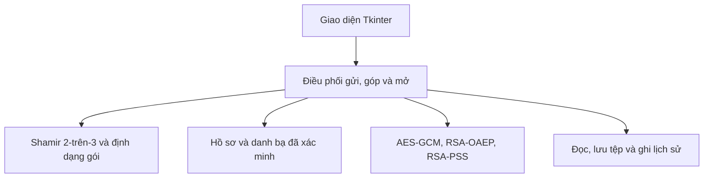
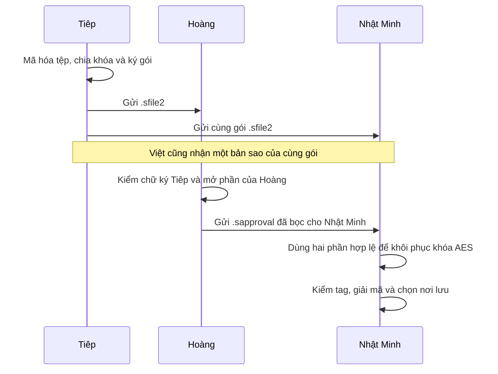

# Chia sẻ tệp bằng Shamir 2-trên-3

Shared-Files-Security là ứng dụng desktop cục bộ dùng để chia quyền mở một tệp. Tiêp tạo gói cho ba người giữ phần khóa là Nhật Minh, Hoàng và Việt. Bất kỳ hai trong ba người có thể phối hợp mở gói, còn một phần riêng lẻ chưa đủ để khôi phục khóa.

[Tổng quan](#tổng-quan) · [Kiến trúc](#kiến-trúc) · [Mật mã](#mật-mã-và-định-dạng-gói) · [Cài đặt](#cài-đặt-và-khởi-chạy) · [Demo](#chạy-demo) · [Kiểm thử](#kiểm-thử) · [Giới hạn](#giới-hạn)

## Tổng quan

- **Tạo gói.** Người gửi chọn đúng ba liên hệ đã xác minh. Ứng dụng mã hóa tệp một lần, chia khóa AES thành ba phần, bọc mỗi phần cho một người giữ rồi ký gói.
- **Góp một phần.** Một người giữ mở phần của mình bằng khóa riêng và xuất tệp đóng góp được bọc cho người giữ sẽ mở gói.
- **Mở và lưu.** Người mở dùng phần của mình và phần hợp lệ nhận được từ một người giữ khác. Ứng dụng kiểm tra hai phần thuộc cùng gói, khôi phục khóa AES và hỏi nơi lưu sau khi giải mã thành công.

| Tệp | Ai dùng và dùng để làm gì? |
|---|---|
| `.sfile2` | Tiêp chuyển cùng một gói cho cả ba người giữ. Gói chứa tệp mã hóa và ba phần khóa được bọc riêng. |
| `.sapproval` | Hoàng xuất phần đóng góp dành cho Nhật Minh. Nhật Minh dùng tệp này với chính gói mà Hoàng đã chọn. |
| JSON khóa công khai | Dùng khi nhập liên hệ và đối chiếu hai dấu vân tay. |
| `.sbackup` | Bản sao lưu hồ sơ có khóa riêng được mã hóa. Chủ hồ sơ lưu giữ để khôi phục khi cần. |

Ứng dụng nhận tệp gốc tối đa **10 MiB**, gồm tệp rỗng, dữ liệu nhị phân và tên Unicode. Gói ngoài tối đa **15 MiB**, phần đóng góp tối đa **2 KiB**. Người dùng tự chuyển các tệp qua email, chat hoặc USB.

## Kiến trúc



| Thành phần | Vai trò |
|---|---|
| [Giao diện](secure_share/ui/app.py) và [khởi tạo](secure_share/application.py) | Ba tab **Khóa của tôi**, **Người liên hệ** và **Chia sẻ 2-trên-3**. Tác vụ dài chạy ở luồng nền. |
| [Điều phối](secure_share/service.py) | Giữ một tác vụ tại một thời điểm và giữ dữ liệu đã giải mã trong bộ nhớ cho đến khi người dùng lưu hoặc hủy. |
| [Shamir](secure_share/threshold.py) và [luồng Shamir](secure_share/threshold_workflow.py) | Chia và ghép khóa, đọc gói, xác thực người gửi, ràng buộc phần đóng góp với gói và người mở. |
| [Mật mã](secure_share/crypto_ops.py) | Các phép mã hóa, bọc khóa và xác minh chữ ký qua thư viện `cryptography`. |
| [Hồ sơ](secure_share/keys.py) và [danh bạ](secure_share/trust_store.py) | Tạo hai cặp khóa riêng cho mã hóa và ký, lưu khóa riêng có mật khẩu, xác minh liên hệ, đổi khóa và sao lưu hồ sơ. |
| [Lưu trữ](secure_share/storage.py) và [lịch sử](secure_share/history.py) | Đọc có giới hạn, lưu qua tệp tạm, phục hồi sau gián đoạn và cảnh báo gói đã lưu. |

Trên Windows, hồ sơ, danh bạ, lịch sử và thông tin phục hồi tệp tạm nằm trong `%LOCALAPPDATA%\Shared-Files-Security`. Gói trao đổi, bản sao lưu và bản rõ khôi phục nằm ở vị trí người dùng chọn.

## Mật mã và định dạng gói

| Cơ chế | Vai trò trong luồng |
|---|---|
| **AES-256-GCM** | Mã hóa tên tệp và nội dung bằng khóa ngẫu nhiên 32 byte. Tiêu đề và ba khối phần chia đã bọc được ràng buộc với nội dung qua AAD. |
| **Shamir 2-trên-3** | Khóa AES là giá trị của một đường thẳng tại điểm 0 trên trường modulo `2^521 - 1`. Ba phần chia là ba điểm khác nhau. Hai điểm đủ để nội suy lại khóa. |
| **RSA-3072 OAEP / SHA-256** | Bọc từng phần cho một người giữ. Khi góp phần, người giữ bọc lại phần của mình cho người sẽ mở. |
| **RSA-3072 PSS / SHA-256** | Ký tiêu đề, các phần đã bọc, nonce và nội dung mã hóa. Người nhận kiểm chữ ký của người gửi trước khi mở phần chia. |
| **Fingerprint SHA-256** | Đối chiếu khóa công khai theo hai vai trò. Dấu vân tay được tính trên DER SPKI và hiển thị bằng 64 ký tự hex. |

`.sfile2` có tiêu đề ghi danh sách khóa người giữ theo thứ tự và giá trị băm của từng phần. Chữ ký bảo vệ tiêu đề và toàn bộ các khối mã hóa. Khi nhận `.sapproval`, ứng dụng kiểm tra đúng gói, đúng khóa nhận và đúng phần chia đã ghi trong tiêu đề, rồi mới nội suy và kiểm tag GCM. [Bài báo gốc của Adi Shamir](https://publications.csail.mit.edu/lcs/pubs/pdf/MIT-LCS-TM-134.pdf)



## Cài đặt và khởi chạy

Môi trường demo trên Windows cần **Python 3.12 có Tkinter**. Từ thư mục mã nguồn của bản Shamir, mở ứng dụng bằng:

```powershell
.\start.cmd
```

Lệnh này tạo `.venv` nếu cần, cài thư viện và mở app. Có thể chạy từng bước để kiểm tra môi trường:

```powershell
py -3.12 -m venv .venv
$py = (Resolve-Path .\.venv\Scripts\python.exe).Path
& $py -m pip install -r requirements.txt
& $py -m secure_share --check
& $py -m secure_share
```

## Chạy demo

1. **Tạo hồ sơ.** Tạo bốn hồ sơ hiển thị là **Tiêp**, **Nhật Minh**, **Hoàng** và **Việt**. Có thể đặt mã hồ sơ lần lượt là `tiep-demo`, `nhat-minh-demo`, `hoang-demo`, `viet-demo`. Mỗi hồ sơ dùng mật khẩu riêng từ 12 ký tự.
2. **Xác minh.** Mỗi hồ sơ xuất JSON ở **Khóa của tôi → Xuất khóa công khai**. Tiêp nhập và xác minh cả ba người giữ. Mỗi người giữ xác minh Tiêp. Hoàng xác minh thêm Nhật Minh để có thể gửi phần góp cho Nhật Minh. Khi xác minh, nhập fingerprint mã hóa trước và fingerprint chữ ký sau, dựa vào thông tin đã đối chiếu với chủ khóa.
3. **Tạo gói.** Tiêp vào **Chia sẻ 2-trên-3**, chọn Nhật Minh, Hoàng, Việt và bấm **Chọn tệp và tạo gói**. Chọn tệp nguồn, lưu `.sfile2`, xác nhận rồi nhập mật khẩu của mình.
4. **Góp phần.** Hoàng chọn Nhật Minh trong mục **Góp một phần khóa**, bấm **Chọn gói và xuất .sapproval** rồi dùng mật khẩu của mình. Chuyển tệp `.sapproval` cho Nhật Minh.
5. **Mở và kiểm tra.** Nhật Minh bấm **Chọn .sfile2 và .sapproval**, nhập mật khẩu của mình rồi lưu bản rõ. Dùng công cụ so tệp để đối chiếu byte và SHA-256.
6. **Thử thiếu phần hoặc đổi người góp.** Chỉ có gói và khóa riêng của Nhật Minh thì chưa đủ. Nếu Việt góp phần dành cho Nhật Minh, Nhật Minh có thể mở với cặp này. Tệp góp phần sai gói hoặc sai đích sẽ bị từ chối.

Demo tự động tạo hồ sơ và tệp giả trong thư mục tạm, rồi kiểm tra một người giữ chưa đủ và cả ba cặp hợp lệ đều khôi phục đúng tệp.

```powershell
$py = (Resolve-Path .\.venv\Scripts\python.exe).Path
& $py -m tools.demo
```

## Kiểm thử

```powershell
# Chạy riêng Shamir, gồm kiểm thử luồng qua Tkinter
& $py -m pytest -q tests/unit/test_threshold.py tests/unit/test_ui_threshold.py tests/integration/test_threshold_workflow.py tests/integration/test_threshold_tk.py

# Chạy toàn bộ suite và xuất kết quả theo mã nghiệm thu
& $py -m tools.case_report --run --json .test-results/cases.json
```

Bộ Shamir kiểm tra cả ba cặp và cả hai chiều góp phần, thiếu phần, trùng người giữ, sai gói, sai đích, chữ ký sai, khóa cũ sau khi đổi, biên 10 MiB và các thao tác lưu hoặc hủy. Lượt kiểm thử đầy đủ cũng chạy 60 mã hồi quy của giao thức trước để bảo vệ những phần dùng chung như khóa, danh bạ, mật mã và lưu trữ.

## Công cụ và benchmark

```powershell
& $py -m tools.make_test_data --out .test-results/demo-inputs
& $py -m tools.compare_files .test-results/demo-inputs/binary.bin .test-results/restored.bin
& $py -m tools.benchmark --repeats 3
```

`compare_files` dùng sau khi đã lưu tệp khôi phục vào đường dẫn tương ứng. Benchmark chạy luồng 2-trên-3 thật trên dữ liệu giả, đo riêng **tạo gói**, **góp phần** và **mở rồi lưu**, sau đó đối chiếu hash bản rõ với bản gốc.

## Giới hạn

- Danh tính gắn với khóa đã đối chiếu fingerprint. Nếu Tiêp xác minh nhầm khóa, phần chia sẽ được bọc cho chủ của khóa đó.
- Ngưỡng tính theo hai phần hợp lệ từ hai khóa giữ khác nhau. Tệp đóng góp đã xuất có thể dùng lại với cùng gói và cùng khóa nhận.
- Sau khi lưu bản rõ, người mở có thể sao chép tệp. Mật khẩu, khóa riêng và bản sao lưu do chủ hồ sơ tự giữ.
- Đây là bản mẫu học tập. Dùng dữ liệu giả khi demo.

## Thành viên

| Thành viên | Phần phụ trách |
|---|---|
| Tiệp | Điều phối luồng và tích hợp. |
| Nhật | Hồ sơ, khóa và xác minh liên hệ. |
| Hoàng | Mật mã và định dạng gói. |
| Việt | Giao diện và lưu tệp. |
| Quang | Kiểm thử, demo và benchmark. |
