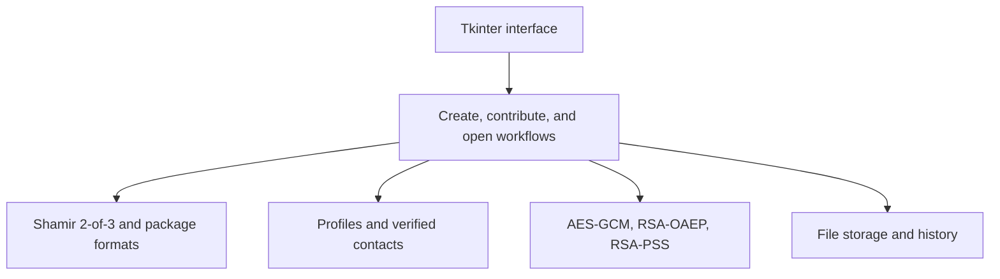
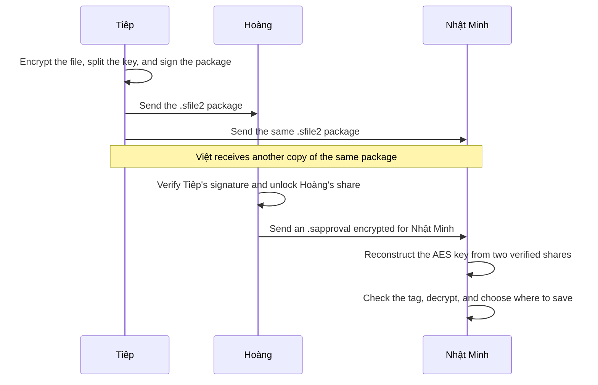

# Shamir 2-of-3 Secure File Sharing

Shared-Files-Security is an offline desktop app for sharing an encrypted file among three designated key holders. In the demo, Tiêp creates a package for Nhật Minh, Hoàng, and Việt. Any two holders can work together to open it. One share alone is insufficient to recover the encryption key.

[Overview](#overview) · [Architecture](#architecture) · [Cryptography](#cryptography-and-file-formats) · [Setup](#setup) · [Demo](#demo) · [Testing](#testing) · [Tools and benchmarks](#tools-and-benchmarks) · [Limitations](#limitations)

## Overview

- **Create a package.** The sender selects three verified contacts. The app encrypts the file once, splits the AES key into three shares, wraps each share for its holder, and signs the package.
- **Contribute a share.** A holder unlocks their own share with their private key and exports it encrypted for another designated holder.
- **Open and save.** The recipient combines their own share with the contribution. The app checks that both shares belong to the same package, reconstructs the AES key, and prompts for a save location after successful decryption.

| File | Purpose |
|---|---|
| `.sfile2` | Tiêp sends a copy of the same package to all three holders. It contains the encrypted file and three individually wrapped key shares. |
| `.sapproval` | Hoàng exports a share encrypted for Nhật Minh. Nhật Minh uses it with the exact package Hoàng selected. |
| Public-key JSON | Users exchange these files to import contacts and verify both key fingerprints. |
| `.sbackup` | An encrypted backup of a profile's private keys. The profile owner keeps it for recovery. |

Source files may be up to **10 MiB**, including empty files, binary files, and files with Unicode names. The package limit is **15 MiB**, and the contribution limit is **2 KiB**. Users transfer the files through an existing channel such as email, chat, or USB.

## Architecture



| Component | Responsibility |
|---|---|
| [Interface](secure_share/ui/app.py) and [startup](secure_share/application.py) | Build the profile, contact, and threshold-sharing tabs. Long-running tasks run in the background. |
| [Workflow service](secure_share/service.py) | Runs one operation at a time and holds decrypted content in memory until the user saves or cancels. |
| [Shamir](secure_share/threshold.py) and [threshold workflow](secure_share/threshold_workflow.py) | Split and reconstruct keys, parse packages, verify senders, and bind contributions to the package and recipient. |
| [Cryptography](secure_share/crypto_ops.py) | Encrypts content, wraps shares, and signs or verifies packages using `cryptography`. |
| [Profiles](secure_share/keys.py) and [contacts](secure_share/trust_store.py) | Manage separate encryption and signing key pairs, password-protected private keys, contact verification, key rotation, and backups. |
| [Storage](secure_share/storage.py) and [history](secure_share/history.py) | Enforce input limits, save through temporary files, recover from interrupted writes, and warn when a package has already been saved. |

On Windows, the app stores profiles, contacts, history, and temporary-file recovery records in `%LOCALAPPDATA%\Shared-Files-Security`. Users choose where to save packages, backups, and recovered files.

## Cryptography and file formats

| Mechanism | Role |
|---|---|
| **AES-256-GCM** | Encrypts the filename and file contents with a random 32-byte key. Additional authenticated data (AAD) binds the header and the three wrapped shares to the ciphertext. |
| **Shamir 2-of-3** | The AES key is the value at zero of a line over the finite field modulo `2^521 - 1`. Each share is a distinct point on that line. Any two points can reconstruct the key by interpolation. |
| **RSA-3072 OAEP with SHA-256** | Wraps each share for its holder. A contributor uses it again to wrap their share for the holder who will open the package. |
| **RSA-3072 PSS with SHA-256** | Signs the header, wrapped shares, nonce, and ciphertext. Each holder verifies the sender's signature before unlocking a share. |
| **SHA-256 fingerprints** | Identify public keys during verification. Each fingerprint is a 64-character hexadecimal SHA-256 digest of the key's DER-encoded SubjectPublicKeyInfo. |

The `.sfile2` header lists the holders' keys in order and contains a commitment to each share. The signature covers the header and all encrypted fields. When a recipient loads an `.sapproval` file, the app checks the package and recipient bindings and verifies the shares against the signed commitments. It then reconstructs the AES key and verifies the GCM tag before releasing the file contents. [Shamir's original paper](https://publications.csail.mit.edu/lcs/pubs/pdf/MIT-LCS-TM-134.pdf)



## Setup

The Windows demo requires **Python 3.12 with Tkinter**. Run the launcher from the repository root.

```powershell
.\start.cmd
```

The launcher creates `.venv` if needed, installs the dependencies, and starts the app. You can also run setup manually.

```powershell
py -3.12 -m venv .venv
$py = (Resolve-Path .\.venv\Scripts\python.exe).Path
& $py -m pip install -r requirements.txt
& $py -m secure_share --check
& $py -m secure_share
```

## Demo

The app uses Vietnamese labels. The steps below retain those labels so they match the interface.

1. **Create profiles.** Create profiles for **Tiêp**, **Nhật Minh**, **Hoàng**, and **Việt**. Suggested profile IDs are `tiep-demo`, `nhat-minh-demo`, `hoang-demo`, and `viet-demo`. Use a separate passphrase of at least 12 characters for each profile.
2. **Verify contacts.** Each profile exports a public-key JSON file under **Khóa của tôi → Xuất khóa công khai**. Tiêp imports and verifies all three holders. Each holder verifies Tiêp, and Hoàng also verifies Nhật Minh. Compare each fingerprint with the key owner through an independent channel, then enter the encryption fingerprint followed by the signing fingerprint.
3. **Create the package.** As Tiêp, open **Chia sẻ 2-trên-3**, select Nhật Minh, Hoàng, and Việt, and click **Chọn tệp và tạo gói**. Select a source file and a destination for the `.sfile2` package, confirm the holders, and enter Tiêp's passphrase.
4. **Contribute a share.** As Hoàng, select Nhật Minh under **Góp một phần khóa** and click **Chọn gói và xuất .sapproval**. Select Tiêp's package and a destination, confirm the recipient, and enter Hoàng's passphrase. Send the resulting `.sapproval` file to Nhật Minh.
5. **Open and verify.** As Nhật Minh, click **Chọn .sfile2 và .sapproval**, select both files, enter Nhật Minh's passphrase, and save the recovered file. Use the comparison tool to check the bytes and SHA-256 against the original.
6. **Try another pair.** Nhật Minh's key alone is insufficient. After verifying Nhật Minh's keys, Việt can export a contribution for Nhật Minh so that pair can also open the file. The app rejects contributions for a different package or recipient.

The automated demo creates temporary profiles and sample files. It checks that one holder alone is blocked and that all three valid pairs recover the original file.

```powershell
$py = (Resolve-Path .\.venv\Scripts\python.exe).Path
& $py -m tools.demo
```

## Testing

```powershell
# Run the Shamir tests, including the Tkinter workflow
& $py -m pytest -q tests/unit/test_threshold.py tests/unit/test_ui_threshold.py tests/integration/test_threshold_workflow.py tests/integration/test_threshold_tk.py

# Run the full suite and write a report by acceptance case
& $py -m tools.case_report --run --json .test-results/cases.json
```

The Shamir suite covers all three pairs in both contribution directions, missing shares, duplicate holders, mismatched packages or recipients, invalid signatures, retained keys after rotation, the 10 MiB boundary, and saving or cancelling. The full suite also runs 60 regression cases for the earlier protocol to check shared components such as keys, contacts, cryptography, and storage.

## Tools and benchmarks

```powershell
& $py -m tools.make_test_data --out .test-results/demo-inputs
& $py -m tools.compare_files .test-results/demo-inputs/binary.bin .test-results/restored.bin
& $py -m tools.benchmark --repeats 3
```

Run `compare_files` after saving the recovered file to the corresponding path. The benchmark runs the actual 2-of-3 workflow on synthetic data. It measures package creation, share contribution, and opening plus saving separately, then compares the SHA-256 of the recovered file with the original.

## Limitations

- Identity depends on verifying the correct fingerprints. If Tiêp verifies the wrong key, the share is wrapped for the owner of that key.
- The threshold requires valid shares from two distinct holder keys. An exported contribution can be reused for the same package and recipient key.
- Once saved, the plaintext can be copied by the person who opened it. Each profile owner is responsible for their passphrase, private keys, and backup.
- This is an educational project. Use synthetic data for demonstrations.

## Team

| Member | Tasks | Deliverable |
|---|---|---|
| Tiệp | Coordinate integration, review changes across modules, and track issues before the demo. | A tested demo commit and a checklist of open issues and owners. |
| Nhật | Maintain profiles, public-key exchange, fingerprint verification, key rotation, and backup recovery. | A walkthrough that shows how to verify a contact and open a package using a retained key after rotation. |
| Hoàng | Maintain Shamir splitting and reconstruction, AES and RSA integration, and the package and contribution formats. | A protocol walkthrough explaining why two shares recover the key and how contributions are bound to the package and recipient. |
| Việt | Maintain the Tkinter workflow and safe file saving. Check file selection, cancellation, and overwrite confirmation. | A working interface walkthrough from package creation through saving the recovered file. |
| Quang | Own automated tests and benchmarks. Cover all three holder pairs, mismatched contributions, and the file-size boundary. | The acceptance JSON and benchmark results for the demo commit. |
| Hiền Anh | Lead manual acceptance and demo rehearsal. Run the workflow with separate profiles on two machines, including a valid pair, a missing share, and a contribution sent to the wrong holder. | A step-by-step demo script, expected and observed results, and screenshots or a short recording using sample data. |
| Vinh | Own setup and release checks. Verify the launcher on a clean Windows checkout, review the Windows and Ubuntu CI jobs, and document setup failures and fixes. | A reproducible setup checklist with the Python version, commands, and CI links for the demo commit. |
